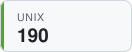
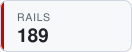
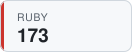
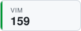
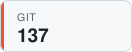
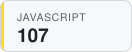
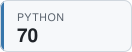
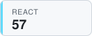
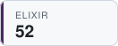

## Hi, I'm Josh 👋

## Latest TILs

<!-- TIL-START -->
- [Generate Random Secret Value With urandom](https://github.com/jbranchaud/til/blob/master/unix/generate-random-secret-value-with-urandom.md) `unix` · 2026-11-11
- [Reheat A Chilled String](https://github.com/jbranchaud/til/blob/master/ruby/reheat-a-chilled-string.md) `ruby` · 2026-11-09
- [Connect To App Database With `dbconsole`](https://github.com/jbranchaud/til/blob/master/rails/connect-to-app-database-with-dbconsole.md) `rails` · 2026-11-08
- [Compute Cosine Similarity Of Vector Embeddings](https://github.com/jbranchaud/til/blob/master/postgres/compute-cosine-similarity-of-vector-embeddings.md) `postgres` · 2026-11-07
- [Set Env Var With Dokku Without A Restart](https://github.com/jbranchaud/til/blob/master/devops/set-env-var-with-dokku-without-a-restart.md) `devops` · 2026-11-07
<!-- TIL-END -->

I've written <!-- TIL-COUNT-START -->1,907<!-- TIL-COUNT-END --> TILs and counting, more at [jbranchaud/til](https://github.com/jbranchaud/til).

### Top TIL Topics

<!-- TIL-TOP-START -->
<a href="https://github.com/jbranchaud/til/tree/master/unix"><picture><source media="(prefers-color-scheme: dark)" srcset="assets/tiles/unix-190-dark.svg"></picture></a>
<a href="https://github.com/jbranchaud/til/tree/master/rails"><picture><source media="(prefers-color-scheme: dark)" srcset="assets/tiles/rails-189-dark.svg"></picture></a>
<a href="https://github.com/jbranchaud/til/tree/master/postgres"><picture><source media="(prefers-color-scheme: dark)" srcset="assets/tiles/postgres-176-dark.svg"></picture></a>
<a href="https://github.com/jbranchaud/til/tree/master/ruby"><picture><source media="(prefers-color-scheme: dark)" srcset="assets/tiles/ruby-173-dark.svg"></picture></a>
<a href="https://github.com/jbranchaud/til/tree/master/vim"><picture><source media="(prefers-color-scheme: dark)" srcset="assets/tiles/vim-159-dark.svg"></picture></a>
<a href="https://github.com/jbranchaud/til/tree/master/git"><picture><source media="(prefers-color-scheme: dark)" srcset="assets/tiles/git-137-dark.svg"></picture></a>
<a href="https://github.com/jbranchaud/til/tree/master/javascript"><picture><source media="(prefers-color-scheme: dark)" srcset="assets/tiles/javascript-107-dark.svg"></picture></a>
<a href="https://github.com/jbranchaud/til/tree/master/python"><picture><source media="(prefers-color-scheme: dark)" srcset="assets/tiles/python-70-dark.svg"></picture></a>
<a href="https://github.com/jbranchaud/til/tree/master/react"><picture><source media="(prefers-color-scheme: dark)" srcset="assets/tiles/react-57-dark.svg"></picture></a>
<a href="https://github.com/jbranchaud/til/tree/master/elixir"><picture><source media="(prefers-color-scheme: dark)" srcset="assets/tiles/elixir-52-dark.svg"></picture></a>
<!-- TIL-TOP-END -->

## Latest Blogmarks

<!-- BLOGMARKS-START -->
- [Building "Recipe Box" with Lovable](https://still.visualmode.dev/blogmarks/363) `ai-assisted-coding` `lovable` · 2026-11-09
- [Render this year's calendar in the browser](https://still.visualmode.dev/blogmarks/362) `python` `calendar` · 2026-11-05
- [Low floor / High ceiling](https://still.visualmode.dev/blogmarks/361) `llm` `ai-assisted-coding` · 2026-10-25
- [Generate embeddings for all my TIL posts](https://still.visualmode.dev/blogmarks/360) `llm` `embeddings` `pgvector` `meta-til` · 2026-10-24
- [On "Preventing Paste for a 'Destructive Action' Confirmation Input"](https://still.visualmode.dev/blogmarks/359) `ux` `web-development` · 2026-10-22
<!-- BLOGMARKS-END -->

More at [still.visualmode.dev/blogmarks](https://still.visualmode.dev/blogmarks).
