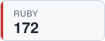
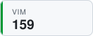
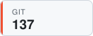
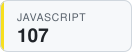
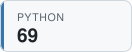

## Hi, I'm Josh 👋

## Latest TILs

<!-- TIL-START -->
- [Rerun Failed Jobs For Current Branch](https://github.com/jbranchaud/til/blob/master/github/rerun-failed-jobs-for-current-branch.md) `github` · 2026-10-15
- [Pick Up Session Locally That Started In Cloud](https://github.com/jbranchaud/til/blob/master/claude-code/pick-up-session-locally-that-started-in-cloud.md) `claude-code` · 2026-10-11
- [Set Repository Secret From CLI](https://github.com/jbranchaud/til/blob/master/github-actions/set-repository-secret-from-cli.md) `github-actions` · 2026-10-07
- [Merge A Sequence Of Lines Of Output](https://github.com/jbranchaud/til/blob/master/unix/merge-a-sequence-of-lines-of-output.md) `unix` · 2026-10-06
- [Ensure Tooltips Appear In Screenshots](https://github.com/jbranchaud/til/blob/master/workflow/ensure-tooltips-appear-in-screenshots.md) `workflow` · 2026-10-04
<!-- TIL-END -->

I've written <!-- TIL-COUNT-START -->1,890<!-- TIL-COUNT-END --> TILs and counting, more at [jbranchaud/til](https://github.com/jbranchaud/til).

### Top TIL Topics

<!-- TIL-TOP-START -->
<a href="https://github.com/jbranchaud/til/tree/master/rails"><picture><source media="(prefers-color-scheme: dark)" srcset="assets/tiles/rails-188-dark.svg"></picture></a>
<a href="https://github.com/jbranchaud/til/tree/master/unix"><picture><source media="(prefers-color-scheme: dark)" srcset="assets/tiles/unix-187-dark.svg"></picture></a>
<a href="https://github.com/jbranchaud/til/tree/master/postgres"><picture><source media="(prefers-color-scheme: dark)" srcset="assets/tiles/postgres-175-dark.svg"></picture></a>
<a href="https://github.com/jbranchaud/til/tree/master/ruby"><picture><source media="(prefers-color-scheme: dark)" srcset="assets/tiles/ruby-172-dark.svg"></picture></a>
<a href="https://github.com/jbranchaud/til/tree/master/vim"><picture><source media="(prefers-color-scheme: dark)" srcset="assets/tiles/vim-159-dark.svg"></picture></a>
<a href="https://github.com/jbranchaud/til/tree/master/git"><picture><source media="(prefers-color-scheme: dark)" srcset="assets/tiles/git-137-dark.svg"></picture></a>
<a href="https://github.com/jbranchaud/til/tree/master/javascript"><picture><source media="(prefers-color-scheme: dark)" srcset="assets/tiles/javascript-107-dark.svg"></picture></a>
<a href="https://github.com/jbranchaud/til/tree/master/python"><picture><source media="(prefers-color-scheme: dark)" srcset="assets/tiles/python-69-dark.svg"></picture></a>
<a href="https://github.com/jbranchaud/til/tree/master/react"><picture><source media="(prefers-color-scheme: dark)" srcset="assets/tiles/react-57-dark.svg"></picture></a>
<a href="https://github.com/jbranchaud/til/tree/master/elixir"><picture><source media="(prefers-color-scheme: dark)" srcset="assets/tiles/elixir-52-dark.svg"></picture></a>
<!-- TIL-TOP-END -->

## Latest Blogmarks

<!-- BLOGMARKS-START -->
- [Comfort Class Authoritarianism](https://still.visualmode.dev/blogmarks/358) `authoritarianism` `facial-recognition` · 2026-10-21
- [Prompting for a Code Comment Reviewer prompt](https://still.visualmode.dev/blogmarks/357) `ai-assisted-coding` `code-comments` `adversarial-review` · 2026-10-18
- [Adversarial Code Review: Why the Maker Shouldn't Grade the Checker](https://still.visualmode.dev/blogmarks/356) `ai-assisted-coding` `adversarial-review` · 2026-10-15
- [Fencepost Error](https://still.visualmode.dev/blogmarks/355) `logic-error` `terminology` · 2026-10-13
- [JSON Lines](https://still.visualmode.dev/blogmarks/354) `json` · 2026-10-11
<!-- BLOGMARKS-END -->

More at [still.visualmode.dev/blogmarks](https://still.visualmode.dev/blogmarks).
